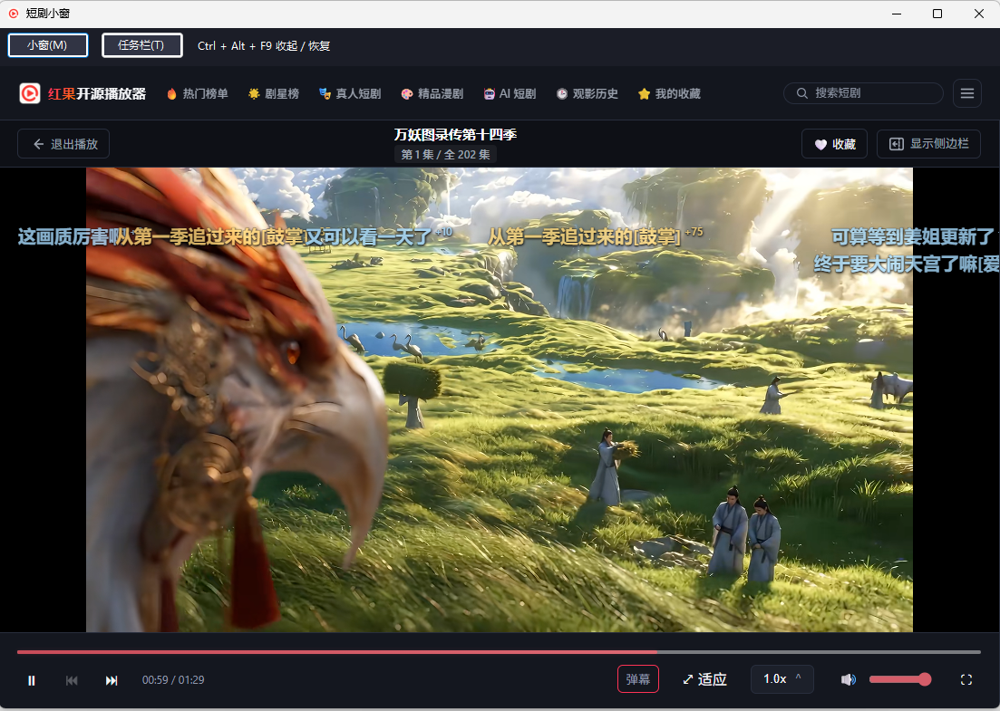
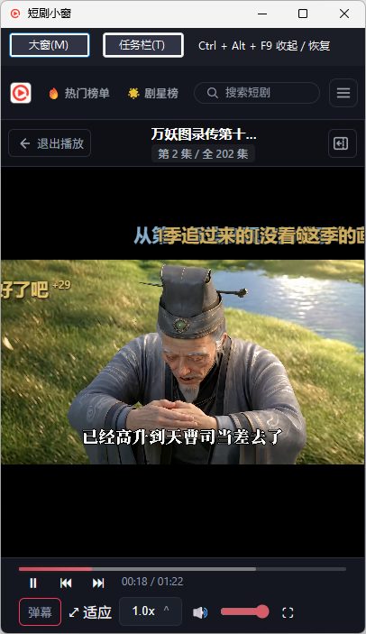

# 短剧小窗 ShortDramaPlayer

短剧小窗是一款 Windows x64 便携播放器，支持红果短剧、抖音视频和短剧、B 站视频和直播。解压即可运行，可在常规窗口、置顶小窗和任务栏预览之间切换。

[下载 Windows x64 便携版](https://github.com/zhangga/ShortDramaPlayer/releases/latest) · [使用说明](desktop/windows/使用说明.txt) · [构建与维护](docs/windows-maintenance.md)

## macOS Apple Silicon 预览版

播放红果短剧、抖音视频或 B 站视频和直播后，点击「贴 Dock」。底部 Dock 旁边有空位时，小窗和 Dock 底边齐平，空间不足时贴 Dock 上沿。单击播放或暂停，双击展开或缩回。贴着 Dock 时，可以用滚轮等比缩放，或按住画面沿 Dock 所在的屏幕边缘拖动。展开后可以自由拖动和缩放，两种状态分别记住各自的大小。右键回到带控制栏的小窗，`Control + Option + F9` 可全局收起或恢复。

点「哔哩哔哩」可在应用内浏览、登录。点「返回播放器」可粘贴视频、直播间或分享链接。切换到贴 Dock 模式会沿用当前网页和登录状态。

## 界面预览

### 常规播放窗口



### 小窗与任务栏

| 置顶竖屏小窗 | 任务栏观看 |
| :---: | :---: |
|  | **任务栏内预览**<br><br><br>**双击展开完整画面**<br> |

## 快速开始

1. 从发布页下载 `ShortDramaPlayer-win-x64.zip`，完整解压到可写目录。
2. 双击 `ShortDramaPlayer.exe`。搜索剧名或从榜单浏览红果短剧，也可以点击顶栏的「哔哩哔哩」在窗口内浏览 B 站。
3. 播放时点窗口上方的「小窗」或「任务栏」，切换观看方式。

支持 Windows 10/11 x64。运行需要网络连接、.NET Framework 4.8 和 Microsoft Edge WebView2 Runtime。[下载 WebView2 Runtime](https://developer.microsoft.com/microsoft-edge/webview2/)

## 观看哔哩哔哩

在内嵌的 B 站网页里，可按 B 站的流程登录。普通视频或直播开始播放后，直接点窗口上方的「任务栏」，即可沿用当前网页的登录状态。单击、双击、拖动和滚轮缩放的操作与红果相同，右键可回到原网页。

普通视频页还可点「在播放器播放」，进入嵌入播放器。点「返回播放器」可以回到链接播放界面，粘贴 B 站视频页链接、`b23.tv` 分享短链接，或输入 BV、av 号。带 `?p=2` 等参数的链接会打开对应分 P。点「在 B 站打开」可回到窗口内的原视频页。

## 观看抖音短剧

点顶栏的「抖音」直接打开短剧频道。抖音的登录和选集在网页内完成。点「返回播放器」，可粘贴视频或短剧单集的分享链接后播放。

播放后，Windows 点窗口上方的「任务栏」，macOS 点「贴 Dock」。右键可回到同一抖音网页，继续当前播放进度。

## 小窗与任务栏观看

| 操作 | 效果 |
| --- | --- |
| 点「小窗」 | 切换为置顶竖屏小窗。点「大窗」恢复原窗口。 |
| 点「任务栏」 | 将正在播放的画面放到主任务栏的空位。 |
| 在任务栏模式下单击画面 | 播放或暂停。 |
| 双击画面 | 从任务栏上方等比展开完整画面。再双击缩回任务栏。 |
| 展开后按住左键拖动 | 移动画面。 |
| 在画面上滚动鼠标滚轮 | 等比缩放。展开时用滚轮调好的大小会在下次展开时恢复，重启后也有效。 |
| 右键单击画面 | 退出任务栏模式，回到播放界面。 |
| 按 `Ctrl + Alt + F9` | 在其他应用里也能收起或恢复窗口。收起时暂停并静音，恢复后按空格继续播放。 |

主任务栏开启自动隐藏或空位不足时，可以使用置顶小窗。任务栏模式的完整操作见压缩包内的 `使用说明.txt`。

## 播放与记录

- 支持剧名搜索、榜单和分类浏览，可按集选择、连续播放和调整弹幕。
- 观看历史、播放进度、收藏和设置保存在解压目录的 `data/` 中。升级时，退出旧版后将整个 `data` 文件夹复制到新版目录即可带走这些记录。

## 从源码构建

在 Windows x64 上运行以下命令，生成 `dist/ShortDramaPlayer-win-x64.zip`。构建依赖和验证步骤见 [Windows 构建与维护](docs/windows-maintenance.md)。

```powershell
pwsh -File .\scripts\package-windows.ps1
```

在 Apple Silicon Mac 上可从源码生成 DMG 和 ZIP，需要 Node.js 22 和 Xcode 命令行工具。

```bash
npm ci
bash scripts/build-bytevc2.sh
npm run build:mac:arm64
```

## 开源来源

短剧小窗基于 `zfdang/hongguo-open-player` 的播放服务和 Vue 界面，加入 WinForms 与 WebView2 窗口、任务栏预览和全局快捷键。[上游源码版本](https://github.com/zfdang/hongguo-open-player/tree/3f687c5b07e04eb194141f8eeb78ded86d646024) · [仓库许可证](LICENSE) · [ByteVC2 解码器来源](vendor/bytevc2/README.md)
